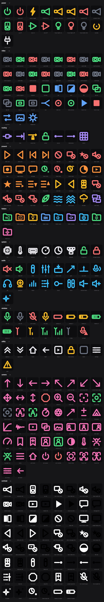

# Companion Icon Pack

261 button icons for [Bitfocus Companion](https://bitfocus.io/companion) and the Stream Deck, drawn for live production: switchers, cameras, presentation, audio, wireless mics, lighting and power. Free to use under the MIT licence.



## Download

| You use | Take |
|---|---|
| Companion 5 | [`icons/library.companionconfig`](icons/library.companionconfig): the whole pack as an image library |
| The Stream Deck app, or anything else | [`icons/png/`](icons/png): 144 × 144 PNGs with transparent backgrounds |
| Your own design work | [`icons/svg/`](icons/svg): the same icons as scalable SVGs |

Use **Code › Download ZIP** above to take everything at once.

## Import into Companion 5

1. Take a full backup first: **Settings › Export › Full backup**. Importing the library can replace images you already have.
2. Import `library.companionconfig` and choose the image library only, leaving pages, buttons and connections unchanged.
3. On a button, add an image layer and set it to `$(image:power-on)`, or any icon's name.

Names that end in a number are numbered on purpose, so a variable can pick the icon. A wireless mic key can show its own battery with `$(image:battery-$(shure:tx1_bars))`.

## Colour means state

Green is on or preview, red is off or program, and amber is a warning or something in between, following the broadcast tally convention. The `contrast` collection carries `-paper` and `-ink` versions for keys whose background colour changes, so an icon stays readable on light and dark.

## Legibility is tested

Every icon is rasterised at real Stream Deck key sizes through Skia, the renderer Companion uses, and checked for ink coverage, for margins and for contrast against the key behind it. An icon that would be hard to read on the deck fails the build.

## Make your own

```bash
npm install
npm test
npm run build    # writes icons/
npm run sheet    # writes contact-sheet.png
```

Shapes live in `src/glyphs/`, drawn once in a 120 × 120 grid. Colours live in `src/palette.js`, and `src/variants.js` pairs each icon name with a shape and a colour.

## Licence

[MIT](LICENSE).
